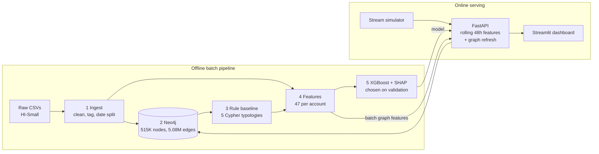

# AML Graph-Screening Engine

Detects money laundering by modelling bank transactions as a **graph**: accounts are nodes, payments are directed, timestamped edges, and an account's risk is judged from its own behaviour **and** the behaviour of the accounts it is connected to. Every score comes with plain-language reasons.

Built on the IBM synthetic AML dataset (HI-Small: 5.08M transactions, 515K accounts, ~0.09% laundering) with Neo4j, XGBoost, TreeSHAP, FastAPI and Streamlit.

## Results (held-out test window, Sep 9–10)

| | Rule baseline | This system | |
|---|---|---|---|
| PR-AUC | 0.013 | **0.267** | ~20× |
| Launderers caught at the rules' alert volume (10,711 alerts) | 16.2% | **54.0%** | **3.3× more** |
| Precision in the top 100 alerts | ~20% | **~96%** | |
| Recall on cycle / fan-out / scatter-gather typologies | 20–23% | **77–83%** | |

- **Graph features matter:** adding graph and neighbourhood features to account-level features raises PR-AUC by 20% (0.223 → 0.267) and recall in the top 1,000 alerts by 32%.
- **Live = offline:** replaying all **862,792** test transactions through the API reproduces the offline result exactly when graph features are fresh.
- **Graph freshness is measurable:** refreshing graph features every 6 hours keeps **94%** of fresh performance; never refreshing halves it.

| Graph refresh schedule | Live PR-AUC | Share of fresh |
|---|---|---|
| Never (2-day-old batch) | 0.127 | 48% |
| Every 24h | 0.193 | 72% |
| Every 12h | 0.233 | 87% |
| Every 6h | 0.251 | 94% |
| Fresh | 0.267 | 100% |


## Architecture



- **Speed layer:** each account's own features are recomputed per transaction over a rolling 48-hour window, using the **same function as training**.
- **Batch layer:** graph features (PageRank, neighbour counts, cycle membership, neighbourhood averages) come from the last refresh, recomputed from the live window by `/admin/refresh-graph`.

## Quick start

Requirements: Linux or macOS, Docker Engine with Compose, Python 3.12, ~16 GB RAM.

```bash
git clone <this repo> && cd aml-graph-engine
python3 -m venv venv && source venv/bin/activate
pip install -r requirements.txt

# Data: download HI-Small_Trans.csv and HI-Small_Patterns.txt from Kaggle
# ("IBM Transactions for Anti Money Laundering") into data/raw/

docker compose up -d neo4j      # graph database
make pipeline                   # stages 1-5: ingest, import, rules, features, train (~15 min)
make up                         # Neo4j + API + dashboard in Docker
make stream                     # replay 5,000 transactions live (or: make stream-full)
```

| Service | URL |
|---|---|
| Dashboard | http://localhost:8501 |
| API docs (interactive) | http://localhost:8000/docs |
| Neo4j browser | http://localhost:7474 (neo4j / password123) |

`make help` lists every command.

## Pipeline

| Stage | Script | What it does |
|---|---|---|
| 1 | `src/ingest.py` | Builds `bank_account` IDs, tags typologies from the pattern file, drops a post-Sep-10 generation artifact, splits by date (train Sep 1–6, val 7–8, test 9–10) |
| 2 | `src/load_neo4j.py` | Bulk import (~20 s) with `neo4j-admin`, indexes, count checks |
| 3 | `src/patterns.py` | Fan-out, fan-in, gather-scatter, scatter-gather and time-ordered cycle rules in Cypher |
| 4 | `src/features.py` | 47 features: volume, USD-normalised amounts, payment mix, pass-through timing, PageRank, components, neighbourhood averages, rule scores |
| 5 | `src/train.py` | Rules vs tabular vs graph vs all-features XGBoost; model chosen on validation among servable models; SHAP |
| 6 | `api/`, `src/simulator.py` | FastAPI scoring service, single-transaction and micro-batch ingest, end-of-window evaluation |
| 6b | `src/staleness.py` | Graph-refresh schedule experiment |
| 7 | `dashboard/` | Alert queue, account investigation with a 2-hop network graph, model performance |

## Design decisions

- **Date-based split, never random**, so the model is always tested on a period after the one it learned from.
- **PR-AUC and recall@K instead of accuracy.** At ~0.4% positives, flagging nothing scores 99.6% accuracy.
- **ML compared with rules at equal alert volume**, i.e. equal analyst workload.
- **Model chosen on validation; test used once.** Only models the live service can compute features for are eligible.
- **Exchange rates estimated from the training data**, since amounts mix USD, EUR, Bitcoin and more.
- **Top SHAP feature investigated and dropped.** Connected-component size looked dominant but was likely a generator artifact (99% of launderers in the giant component); removing it cost nothing.
- **One feature dropped to simplify serving.** The neighbours' rule count needed the Cypher rule engine live; removing it cost 0.02 PR-AUC.
- **Training–serving parity verified:** live account features match offline features for every account at the end of the window.
- **Three live-evaluation bugs found and fixed:** features built from too little history (warm-started 48h window), labels mismatched to the feature window, and a feature exceeding its training range (calendar days in a rolling window).

## Live serving

| Mode | Throughput (laptop) | Latency |
|---|---|---|
| One transaction per request | ~9–13 tx/s | p50 ~84 ms, p95 ~179 ms |
| Micro-batches of 10,000 | full test window (862,792 tx) in one run | vectorised rescoring per batch |

Main endpoints: `POST /transaction`, `POST /transactions/batch`, `GET /score/{account}`, `GET /alerts`, `GET /subgraph/{account}`, `POST /admin/refresh-graph`, `POST /admin/rescore-all`.

## Limitations

- Synthetic data; performance on real bank data is unknown, and some strong signals (e.g. ACH share) likely reflect the generator.
- On laundering outside the named typologies, the tabular model beats the graph model (recall 0.36 vs 0.26).
- Ten usable days of data: no long-term drift can be studied.
- Simulated streaming from a file rather than Kafka; live state is in memory (a feature store such as Redis in production).
- SHAP explains what the model relied on, not proof of laundering. Scores are a reason to investigate.

## Roadmap

- Scale to HI-Medium (~30M transactions) with Polars or DuckDB.
- GNN baseline (GraphSAGE / directed multigraph GNN) against XGBoost.
- Train with deliberately aged graph features to make the model robust to staleness.
- Analyst feedback loop and Kafka ingestion.

## Project structure

```
api/          FastAPI service: scoring engine, Neo4j access, schemas
dashboard/    Streamlit app: alert queue, investigation, model performance
docker/       Dockerfile (one image for API and dashboard)
src/          pipeline stages, simulator, staleness experiment, config
reports/      results tables and figures (generated)
data/, models/, neo4j_data/   generated locally, not in git
```

## References

1. Altman et al., *Realistic Synthetic Financial Transactions for Anti-Money Laundering Models*, NeurIPS 2023 Datasets and Benchmarks. [arXiv:2306.16424](https://arxiv.org/abs/2306.16424)
2. Egressy et al., *Provably Powerful Graph Neural Networks for Directed Multigraphs*, AAAI 2024. [arXiv:2306.11586](https://arxiv.org/abs/2306.11586)
3. Weber et al., *Anti-Money Laundering in Bitcoin: Experimenting with Graph Convolutional Networks for Financial Forensics*, KDD 2019 workshop. [arXiv:1908.02591](https://arxiv.org/abs/1908.02591)
4. Chen & Guestrin, *XGBoost: A Scalable Tree Boosting System*, KDD 2016.
5. Lundberg et al., *From Local Explanations to Global Understanding with Explainable AI for Trees*, Nature Machine Intelligence 2020.
