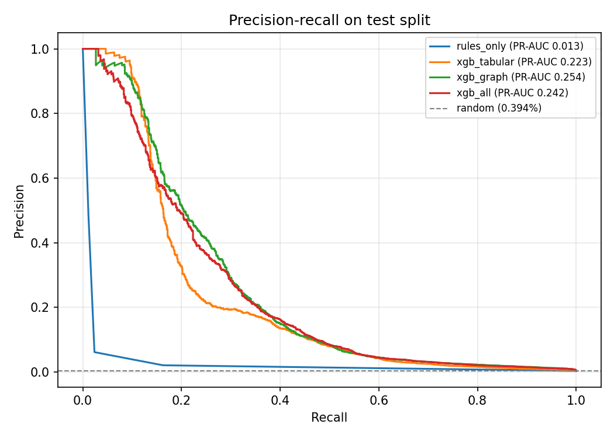
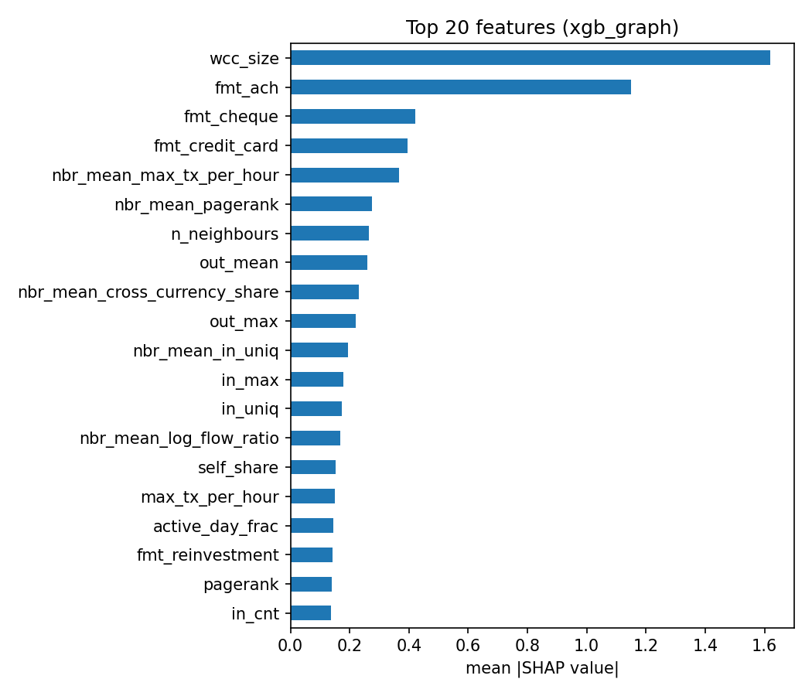

# Results (test split, Sep 9-10)

354,447 accounts, 1,397 laundering (0.39%). Rules raise 10,711 alerts, so ML is compared at the same K.

```
      model  pr_auc  roc_auc  recall@100  recall@1000  recall@10711  prec@10711
 rules_only   0.013    0.567       0.014        0.028         0.162       0.021
xgb_tabular   0.223    0.899       0.070        0.208         0.528       0.069
  xgb_graph   0.254    0.929       0.068        0.268         0.523       0.068
    xgb_all   0.242    0.926       0.064        0.256         0.539       0.070
```

Production model (chosen on validation PR-AUC): **xgb_graph**

## Recall by pattern (top 10,711 alerts)

```
       pattern  accounts  rules_only  xgb_all  xgb_graph  xgb_tabular
         OTHER       635        0.17     0.25       0.24         0.36
GATHER-SCATTER       154        0.14     0.84       0.84         0.79
         STACK       151        0.18     0.72       0.71         0.68
SCATTER-GATHER       130        0.20     0.82       0.81         0.63
     BIPARTITE        84        0.27     0.69       0.70         0.60
       FAN-OUT        81        0.21     0.84       0.83         0.65
         CYCLE        78        0.23     0.78       0.72         0.65
        FAN-IN        75        0.21     0.69       0.71         0.76
        RANDOM        59        0.14     0.85       0.85         0.73
```




